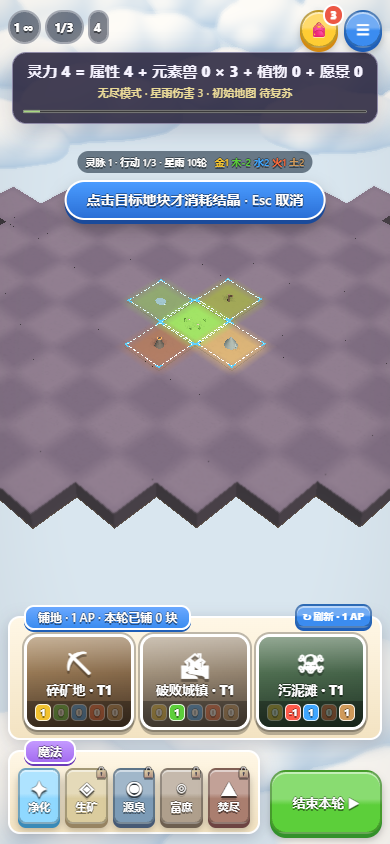
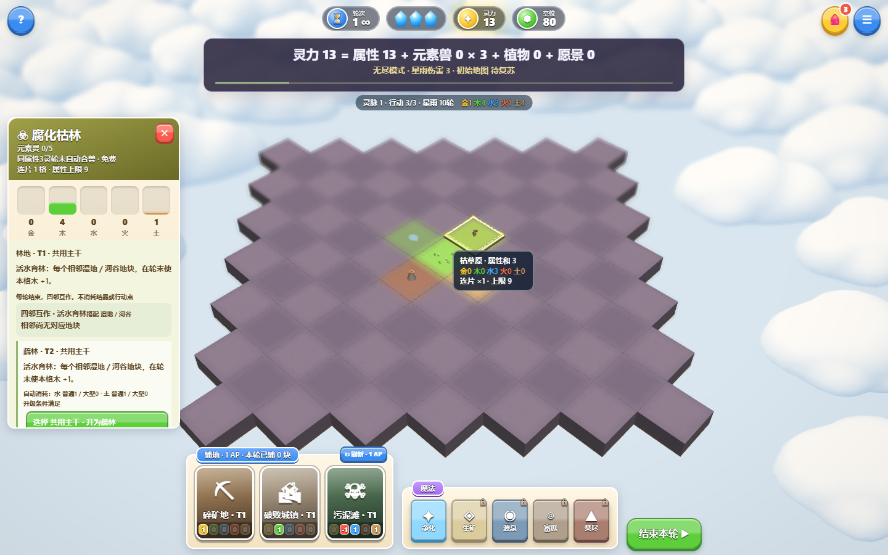

# 结晶须明确选择目标使用（2026-10-14）

取消“已选地块时点背包结晶立即使用”的快捷路径。现在先选普通／大型／逆结晶，背包与详情收起，再点击目标地块才扣库存；按Esc取消不会消耗，普通点选地块也不会消耗。手机提示条保持紧凑，避免遮住目标。教学和帮助同步说明两步操作。

地块回合结算不会自行扣除结晶。地块升级保持原规则：预览不扣晶，明确选择升级方向时自动消耗匹配属性缺口的普通／大型结晶。元素盾制造与至纯结晶扩展魔法的明确使用操作保留。

验证：`npm test`通过，25组规则（含80种地块结算库存检查与30局完整模拟）、13组目录／生态、7200个地形接缝及几何检查；`npm run test:crystal`桌面／手机25项通过，浏览器错误0。验证实际鼠标／触控目标点击、选择不扣晶、取消、普通／大型／逆结晶、HUD与飞行回收，以及升级自动按缺口扣晶。已检查截图。

已发布：https://element-habitat.vercel.app 。部署 `dpl_7Kr8X4wH6EZCu6Ht3UWjkD6qH8fj`，READY / production；游戏源码 `cf532dd80ab101d7ec7ecd4055f8d61777b943b1`。

直接加载正式站点进行同一套桌面／手机25项交互检查，全部通过、浏览器错误0；没有替换线上游戏或渲染代码。报告位于忽略的 `artifacts/crystal-selection-production.json`。手机为模拟视口。
