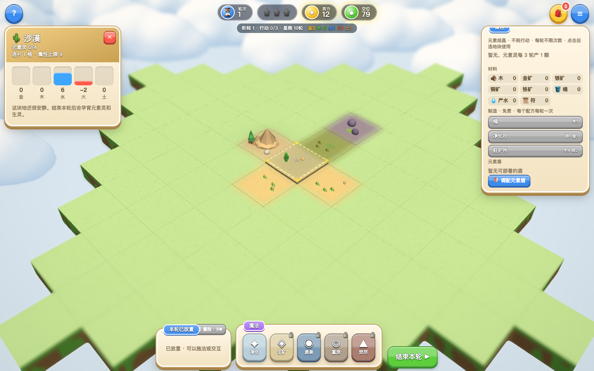
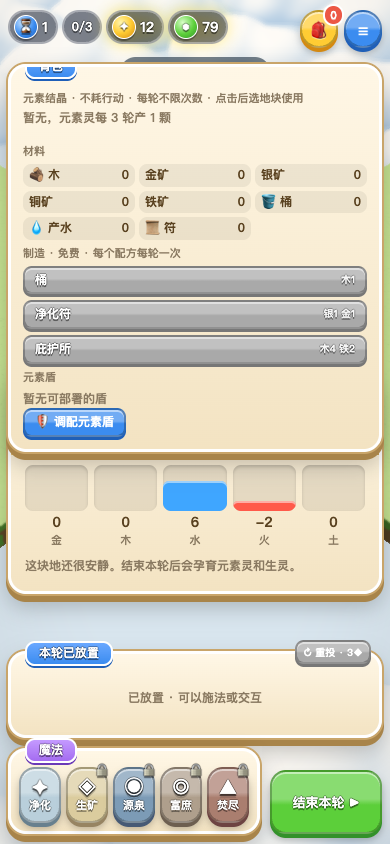

# 元素生境 0.2.2：结晶连续使用

用户在 2026-10-04 明确要求结晶每轮无限使用并发布正式环境。本次取消普通、大型及逆结晶按元素、类型记录的每轮交互锁；其他生物和物品的交互限制保留。

每次使用仍消耗一颗对应库存，普通 +1、大型 +2、逆结晶 −1。不消耗行动点、不触发换轮、不占用地块放置次数，行动点为 0 时也可连续使用。正向属性达到同种连片上限时拒绝使用且不扣库存；库存耗尽时移除对应背包按钮。帮助、背包说明和提示已更新。

此次发布同时包含此前本地 0.2.1 的流星雨、连片地形、感染和护盾特效，以及滑条、加减按钮、快捷配比和固定头尾的造盾面板。效果与验证见 [0.2.1 更新记录](FEEDBACK-2026-10-04.md)，其中部署状态描述为当时历史状态。

## 验证与发布

`npm test` 通过：29 组规则、30 局完整对局、7,200 次共享边/角检查、四种云几何及脚本语法检查。新版桌面/手机 UI 回归 71 项全部通过，无控制台、JavaScript 或 WebGL 错误。见 [本次 UI 报告](crystals-unlimited-ui-report.json)。浏览器使用真实鼠标及模拟触摸，探针仅注入测试请求，测试状态与截图不代表自然对局或实体手机性能。

正式环境已发布 **0.2.2**，状态 `READY`，别名为 [element-habitat.vercel.app](https://element-habitat.vercel.app)。部署 ID：`dpl_BdroLNTmciwRZ7YysJKvRhLXeKQ3`，源码提交：`7b3eb1f`。按用户此前要求不再运行线上检查。

