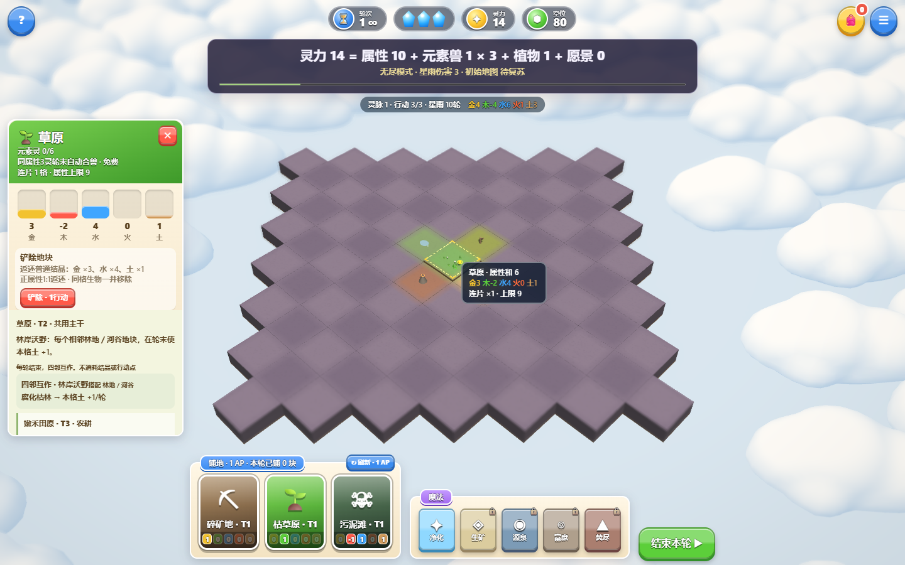
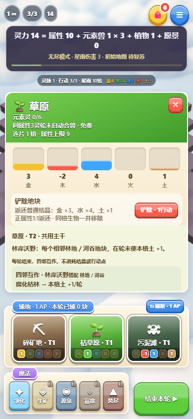
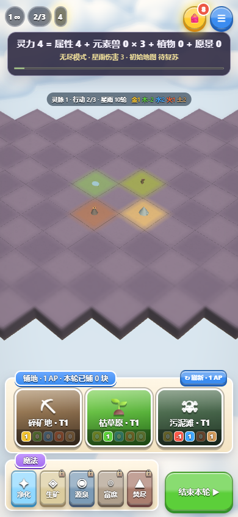

# 地块铲除与结晶返还

用户要求可以用行动点铲除地形，将属性值返还为元素结晶。实现为地块详情中的“铲除 · 1行动”按钮，操作前显示对应返还数量。

- 每次消耗1行动点，不换轮、不刷新待选地块，不增加铺地次数；同轮可重复操作。
- 按地块当前正属性1:1返还对应普通元素结晶；零及负属性不返还，也不扣库存。例如金3／木−2／水4／火0／土1返还金3、水4、土1，共8颗。
- 地块及其生物一并移除，详情关闭，灵力与空位实时更新；结晶飞入背包后计数与实际库存一致。
- 邻接连片重新计算属性上限，铲除留下的相邻空位可以重新铺地。存档保存铲除结果、库存和剩余行动点。
- 行动不足、对局已结束、摄影检视时不能铲除。铲除最后一块沿用地图无地块时失败的既有规则。

## 验证

`npm test` 通过，32组规则、14组目录／生态及7200个地形接缝和几何检查，30局完整模拟全部通关。新增规则检查覆盖混合正负属性返还、非法操作不改变状态、同轮重复、零返还、连片拆分、无尽地图存档与最后地块失败。`npm run test:demolition` 分别通过实际鼠标／触控操作检查返还预览、铲除与生物移除、库存及行动点、计数飞行收束、刷新恢复、空位重铺、无行动拒绝、摄影限制和空地图结束，共17项通过，浏览器错误为0。

已检查桌面和手机模拟截图：按钮与返还数量清晰可见，铲除后空位、行动点与背包库存正确。软件WebGL和手机模拟不代表真实设备性能。

## 正式发布

已发布至 https://element-habitat.vercel.app ，部署 `dpl_E4PQiEDBDrmHs5QXyWEX6LMp7c8A` 为 READY / production；游戏源码提交 `873f9d2b41f4e225796dff4032db7384666b69fc`。

直接加载正式网址执行同一套桌面／手机17项交互检查，全部通过、浏览器错误0，未替换线上游戏或渲染代码。报告在忽略的 `artifacts/demolition-production.json`。
