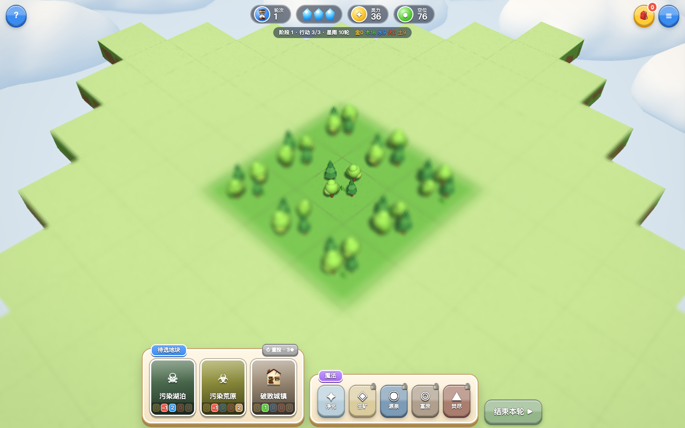
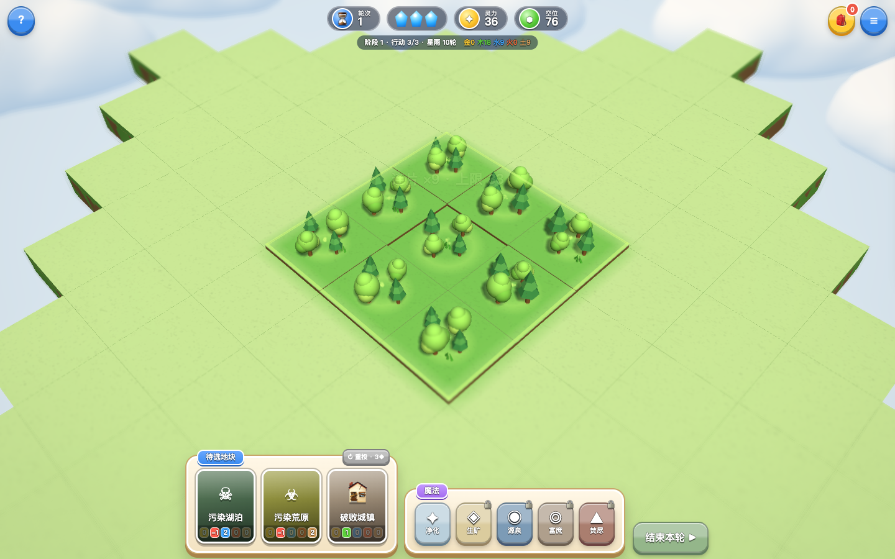
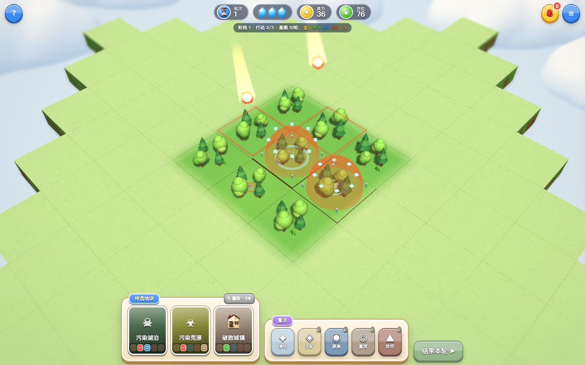
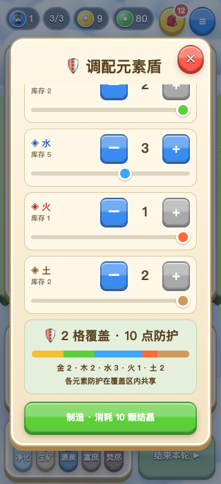

# 元素生境 0.2.1：特效与元素盾交互

本次增强新版玩法的可见反馈，沿用纸面 GUI、明亮卡通微缩地形、云海、Bloom 和景深。

## 可见表现

- **陨星雨**：先标记实际受影响的地块，再分批发射对应元素颜色的流星。流星有旋转核心、渐隐长尾；命中产生扩散波、碎片、尘雾、短震屏与合成音效。元素盾拦截时出现能量罩闪亮和防护碎片，部分拦截仍显示伤害反馈。一次星雨只显示一条区域提示。
- **同种地形连片**：选择或悬停地形时显示整个连片的外轮廓；放置前可预览将连接的区域。落地后，能量波纹和粒子按距离传播到同种地块，配合轻弹跳、连片数量/属性上限飘字与上行音阶。升级也有独立的上升晶片与光束反馈。
- **元素盾**：覆盖格保留随主要防护元素着色的半透明蜂窝能量罩。部署时轮廓亮起，护罩分批展开；选择背包中的盾后进入地图部署模式，预览区域使用规则层的实际连通区域计算。
- **癌元感染**：紫色雾和向中心收拢的晶片让感染更容易辨认。

这些效果读取规则结果；属性、库存、阶段、灾变区域和共享防护池继续由 `game.js` 决定。

## 元素盾调配

取消手写数字，改为五种元素的增减按钮与原生滑条。库存为零的控制禁用；滑条支持键盘方向键及 Home/End。

打开面板时，库存充足会预选一格盾。快捷方案提供一格盾、三格盾、用满库存和清空；三格方案库存不足时禁用。“用满”取可用结晶总数向下凑成 5 的倍数，保留余数。

点击元素名称优先分配该元素，剩余需求按可用库存补入其他元素。彩色配比条、各元素防护量、覆盖格数与总防护量随操作更新。不足 5 的倍数时显示缺口，并可一键补齐。预览不扣库存，只有制造成功时扣除。

窄屏只滚动中间配比区域，标题、关闭按钮和制造按钮固定可见。重新打开会回到配比顶部；库存不足的原因也直接显示在制造按钮上。

## 生命周期与降级

- 特效按 `performance.now()` 记录创建时间、延迟与到期时间，低帧率时仍能及时结束；新生成的命中特效不会误吸收上一帧已经经过的时间。
- 临时网格上限为桌面 360、手机 180；延迟队列上限为桌面 160、手机 80；粒子保留原有桌面 800、手机 400 的上限。预算只约束表现，不改规则结果。
- 连片与区域轮廓批量生成外边界，结束或切换预览时释放独占几何和材质。护罩几何与五种颜色的材质共享。
- 重开清空延迟命中、临时网格、灯光和预览轮廓。减弱动态模式使用短暂静态提示，关闭流星飞行、连片运动和震屏。

## 验证

运行 `npm test`、`npm run test:v1-ui` 和 `npm run test:feedback`。两个浏览器套件顺序运行，默认使用 Playwright Chromium；可以设置 `PLAYWRIGHT_BROWSER_CHANNEL=chrome` 使用本机 Chrome。

新版 UI 回归覆盖真实铺地、连片预览、造盾按钮/滑条/补齐/库存限制、部署区域、星雨、成就、减弱动态及重开。专项套件用固定时钟分别捕捉波纹、护罩、预警、飞行和命中，并检查连续 12 批星雨的资源预算及独占几何回收、视觉不修改规则状态、混合配比和 320 像素窄屏布局。

本次 `npm test` 通过：12 个 JavaScript 文件及内联脚本语法、28 组规则、30 局完整对局、7,200 次共享边/角检查及四种云几何检查。新版 UI 回归 **65 项通过**，特效专项 **27 项通过**，错误列表均为空。浏览器为 Chromium 154.0.8037.93 / SwiftShader，桌面 1440×900、手机 390×844，造盾窄屏另检查 320×700。

报告：[UI 回归](feedback-ui-report.json)、[特效专项](feedback-effects-report.json)。造盾固定头尾布局修正后，再以 `FEEDBACK_UI_ONLY=1 npm run test:feedback` 单独复测桌面与窄屏配比、滚动后的按钮可点击性，**13 项通过**，错误列表为空。见[造盾布局复测](feedback-shield-layout-report.json)，此次不重复特效压力场景。

测试构造的场景用于验证效果和交互，不代表自然对局过程。手机检查为浏览器模拟，不能代表真实设备帧率、温度或耗电。旧版 Python 浏览器套件本次没有重跑，本次结果不称为 `npm run test:all` 通过。

本地试玩：`npm run dev` 后打开 `http://localhost:8080`。正式站点 `https://element-habitat.vercel.app` 当前对应此前部署的 0.2.0；本次 0.2.1 为本地更新。

## 效果截图

以下连片两图为同一测试场景触发反馈前后，非两个代码版本的比较。

触发前：

连片波纹：

流星与护盾拦截：

320 像素窄屏造盾面板滚动后，关闭与制造按钮仍可见、可点击：

