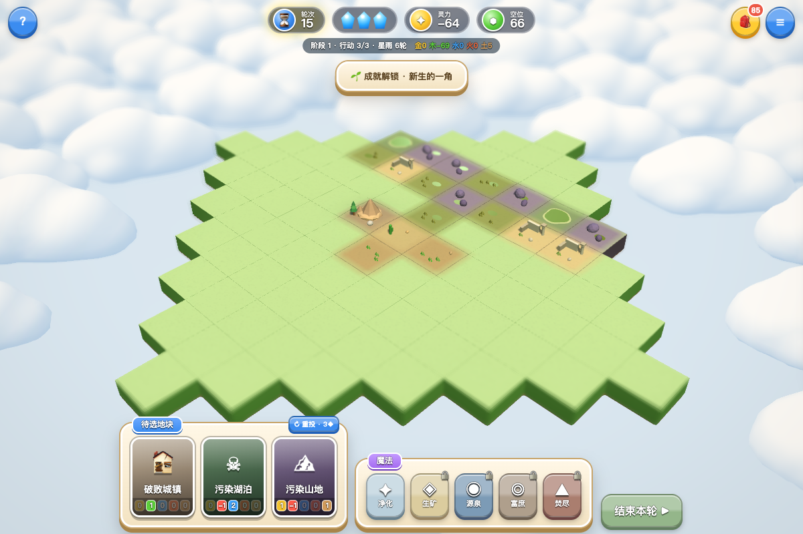
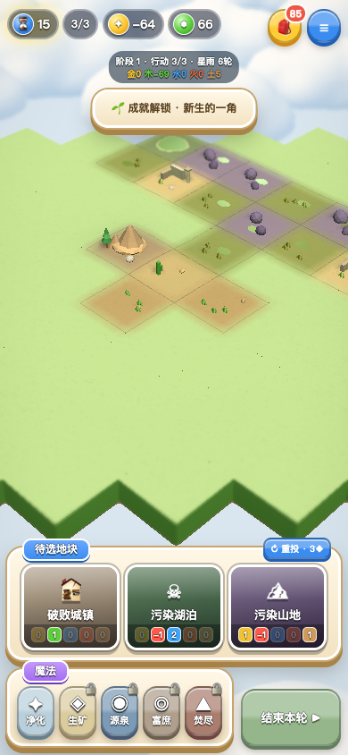

# 0.2.3：绿色底层闪烁修复

用户反馈镜头静止时绿色底层也会闪烁。检查发现绿色地块侧壁延伸到 y=−0.32，连续棕色底座却从 y=−0.34 延伸到 0；二者在棋盘外沿共享 −0.32 至 0 的同一垂直表面。这会产生深度冲突（z-fighting），表现为绿色侧壁上的棕色斑块和闪烁。

底座现仅封闭 −0.34 至 −0.32 的底部，接在绿色侧壁下面，消除整片重叠面。保留棋盘外轮廓、底部高度、地块顶面、连续地形、选框、拾取和动画。无规则或特效时序变化。

## 验证

`npm test` 通过：29 组规则、30 局完整对局、7,200 次共享边/角检查、四种云几何及脚本语法。新增底座与全部 85 格地形的几何检查，要求两者没有重叠的垂直面积。

地面专项 `ground_check.cjs`（对应 `npm run test:ground`）在桌面与手机模拟中，以正面和背面镜头分别检查普通渲染与 Bloom/景深路径；静止镜头跨三个时间采样时，外沿像素保持一致。另检查棋盘底部高度、空位数量、地块拾取和 HUD。前后对比用同一测试场景、镜头与渲染设置，旧代码仅注入测试请求。本次设置 `GROUND_BASELINE_SOURCE` 指向修改前的源文件，包含旧版本对照，共 **35 项通过**，无控制台、JavaScript、着色器或 GL 错误。见 [测试报告](ground-fix-report.json)。

浏览器软件 WebGL 和手机模拟不等同于用户真实 GPU/手机性能验证。正式站点仍为 0.2.2；此次为本地修复。

## 同镜头对比

修复前，外侧绿色面出现棕色斑块：

修复后，外侧绿色面连续：

手机模拟修复后：

