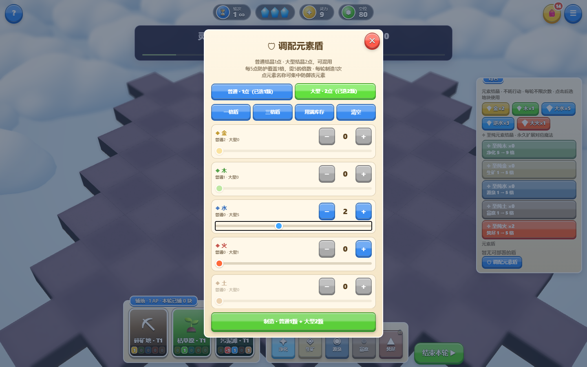
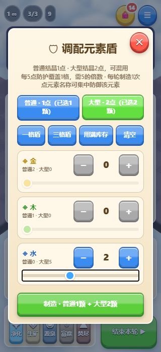
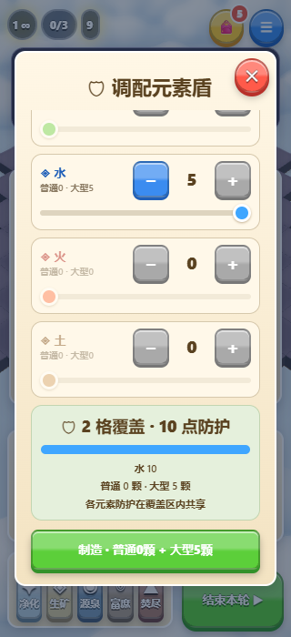

# 大型结晶参与元素盾调配

用户要求大结晶也可以用来合成元素盾。普通结晶每颗提供1点对应元素防护，大型结晶每颗提供2点，可混合使用。

- 保留每5点防护覆盖1格、总点数须为5的正整数倍、每轮制造一次、制造不消耗行动点的规则。
- 例：1颗普通金结晶＋2颗大型水结晶，得到金1／水4，共5点、覆盖1格。单用5颗大型水结晶得到水10，覆盖2格。
- 面板显示两种库存，用普通／大型按钮切换调配，分别保留选中数量。制造按钮显示两种结晶实际消耗量，仅制造成功才扣库存；逆结晶和至纯结晶不参与。
- 一格盾、三格盾、用满库存、元素防御优先和补齐按防护点计算。只有大型结晶时不能组成奇数点配方，补齐会选择能形成的下一档整格防护；库存不足则明确禁用。
- 保留既有盾的存档结构与部署逻辑；大小结晶制造的盾均按最终元素防护和覆盖格数保存。
- 新切换按钮固定两列，避免320px手机点击时因按钮换行导致点击失效。

## 验证

`npm test` 通过，36组规则、14组目录／生态、7200个地形接缝及几何检查，30局完整模拟全部通关。新规则检查包含普通配方、仅大型配方、混合库存精确扣除、存档及非法配比不消费。

`FEEDBACK_UI_ONLY=1 npm run test:feedback` 原普通结晶交互33项通过。`npm run test:large-shield` 桌面及320px手机模拟23项通过、浏览器错误0，验证两种结晶切换、加减与滑条、预设与补齐、实际混合／纯大型造盾、每轮一次、不消耗AP、零AP制造、部署、刷新恢复和库存不足。

已核对截图，手机按钮换行稳定，滚动后关闭与制造按钮可操作，纯大型配方明确显示10点／2格。软件WebGL和手机模拟不代表真实设备性能。

