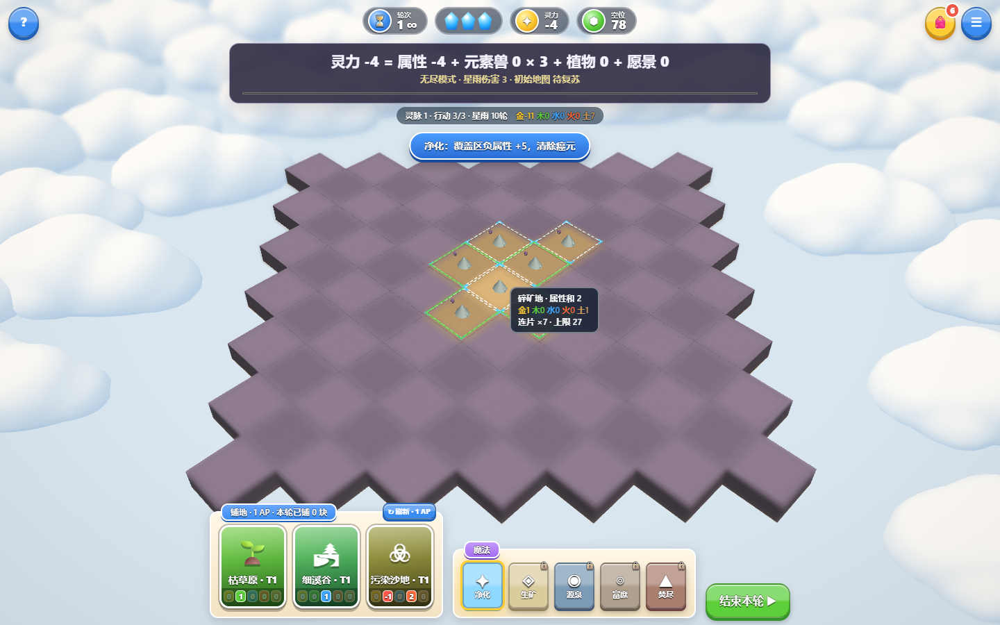
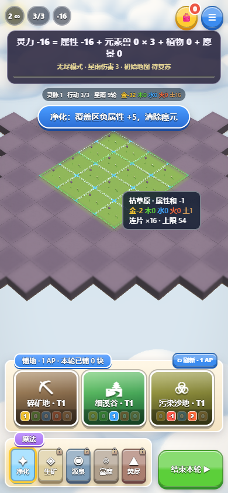
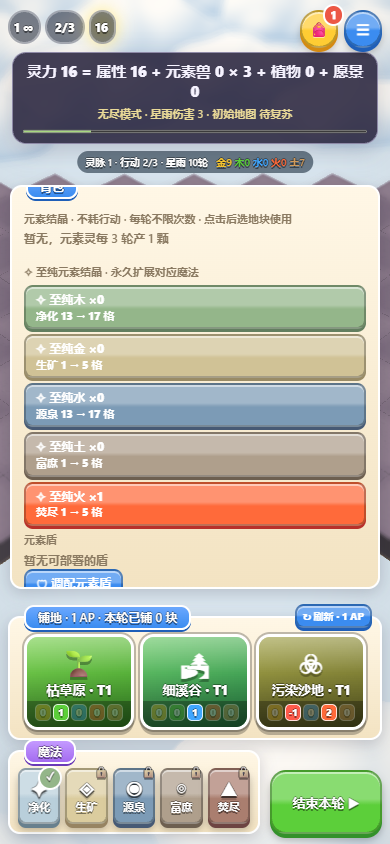
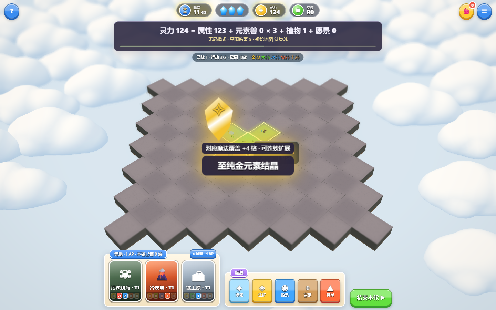

# 至纯结晶与净化范围调整

用户确认每颗至纯结晶增加4格，按1→5→9…连续扩展，移除原来的5格上限。用户所说的“进化魔法”按现有净化处理：第一轮即可施放，初始覆盖目标及周围四邻，共5格。

## 当前规则

- 使用一颗对应元素的至纯结晶，永久增加4格覆盖，消耗该库存，不耗行动、不换轮，也不提前解锁魔法。
- 净化初始5格，使用后9／13／17…；其他魔法初始1格，使用后5／9／13…。
- 初始净化只覆盖目标和已放置的直接四邻，不把缺失邻居替换成远处地块。扩展后沿已放置地块的四邻连接覆盖，实际数量受连通地块数量限制。
- 存档保留已有范围和库存；已发布存档的净化范围不足5格时恢复到5格，超过5格的范围可以正常保存和读取。
- 背包显示当前与使用后的范围；星雨结晶展示、魔法提示和剧情教学同步更新。

## 验证

`npm test` 通过，覆盖规则、30局完整对局模拟、存档和7200个地形接缝及几何检查。新增 `npm run test:magic` 用真实浏览器操作分别检查桌面和手机模拟：首轮四邻净化、连续使用水／木至纯结晶、行动与轮次不变、未解锁魔法、刷新恢复13格、实际13格施法、星雨展示及飞行库存收束，共19项通过，浏览器错误为0。

核对桌面与手机截图，首轮五格预览和扩展13格预览与实际施法一致；背包显示13→17格，至纯结晶中央展示明确标注“+4格 · 可连续扩展”。软件WebGL与手机模拟不代表真实设备性能。

## 正式发布

已发布至 https://element-habitat.vercel.app ，部署 `dpl_BgNWJWhgCyLpmSFN6jzKccgiUyXw` 为 READY / production；游戏源码提交 `2560f10e0d61716e50e757e4b0efb350194040b7`。

直接加载正式网址执行同一套桌面／手机19项交互检查，全部通过、浏览器错误0，未替换线上游戏或渲染代码。报告在忽略的 `artifacts/magic-range-production.json`。完整本地检查为27组规则、14组目录／生态，30局模拟全部通关。
