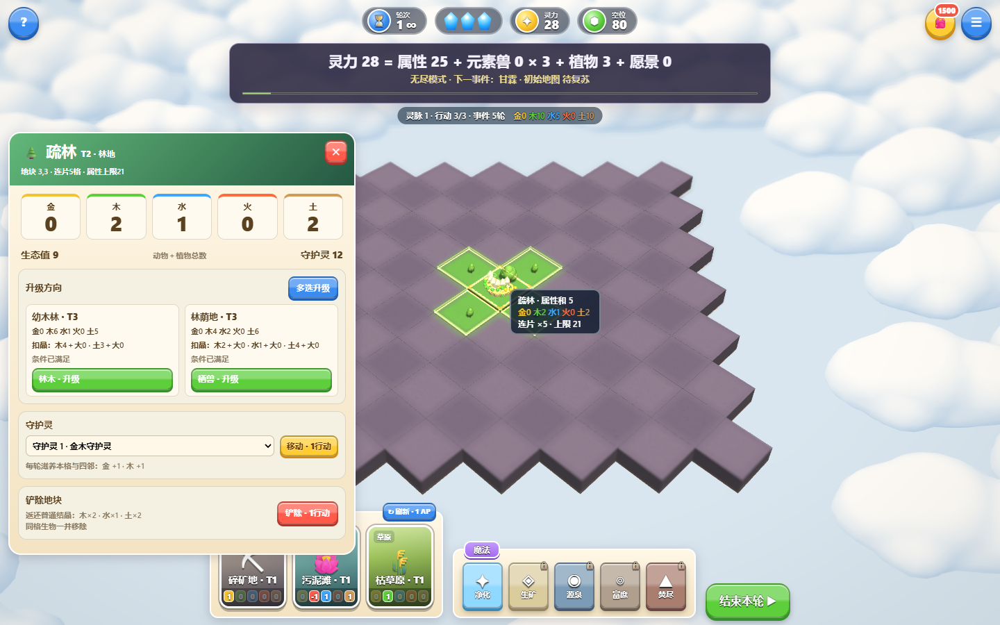
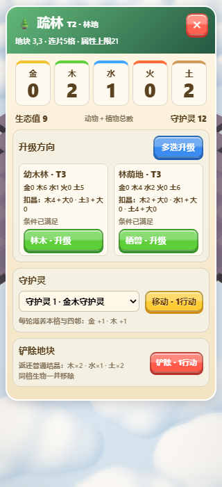
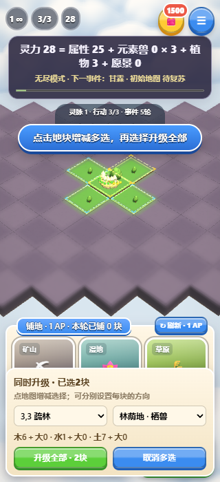
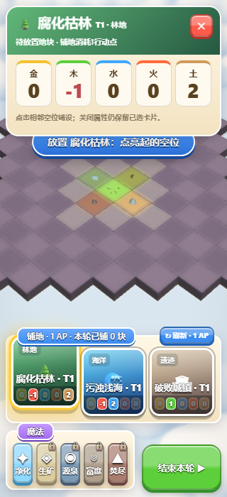

# 自然事件、阶段音乐与地块操作更新

本轮10项需求均已实现。当前规则优先于同日较早的18项调整与历史发布记录。

## 需求对照

| 要求 | 当前实现 |
| --- | --- |
| 每5轮一个大范围自然事件 | 每5轮结算一次事件；按下表轮换，11种事件每55轮循环。HUD显示下一事件及倒计时。 |
| 新增10种正负事件 | 保留元素星雨，另增5种正向、5种负面现象。新增现象作用于全场已放置地块；负属性损失可先由相应元素盾防护吸收。 |
| 第10／20／30／40轮目标 | 分别为500／1500／3000／6000，轮末事件与生态结算后检查，不达标立即失败。 |
| 随灵力变化的背景音乐 | 原创离线合成音乐。初始低回小调；到500、1500、3000、6000时依次转为微光、暖意、舒缓、宁静主题。首次点击后播放；菜单可单独关闭并记住设置。 |
| 同时升级多个地块 | 详情中进入多选，点地图增减地块，可分别指定每块的升级方向。预览合计普通／大型结晶消耗，确认一次执行；任一条件或总库存不足时不部分升级、不部分扣晶。升级仍不耗行动点。 |
| 点击卡片显示地块属性 | 展示待放地块的五元素属性，不扣库存或行动点。关闭属性保留已选卡片；手机预览在顶部，仍可直接点地图铺地。 |
| 系列卡片区分 | 10个系列各有独立配色、图标及系列标签，所有80种地块沿用所属系列卡面。 |
| 放大并简化地块详情 | 桌面宽500px，手机展开为完整属性页。移除动物、植物、元素灵与元素兽列表，仅保留属性、生态值、升级、铲除和守护灵。 |
| 生态值 | 动物实体数量＋植物实体数量，实时计算显示，不改变原来的灵力计分。 |
| 全页同屏，无需下滑 | 升级用两列展示，只有一个方向时占满整行；守护灵数量加选择框替代逐项长列表。80种地块、有无守护灵、四种窗口尺寸共640组合均在视口内。 |

## 事件

下表为基础数值，实际属性变化乘以强度 `ceil(轮次/10)`。正向属性仍受连片上限限制；星雨保留局部连片命中、共享护盾与对应至纯结晶的落下展示。无尽模式继续轮换与增强。

| 首次轮次 | 事件 | 类型 | 属性变化 |
| --- | --- | --- | --- |
| 5 | 甘霖 | 正向 | 木+3、水+8、土+3 |
| 10 | 元素星雨 | 负面 | 随机元素伤害为1＋2×强度；剧情教学首次固定为土 |
| 15 | 春风 | 正向 | 木+8、土+4 |
| 20 | 地脉涌动 | 正向 | 金+4、土+8 |
| 25 | 丰饶辉光 | 正向 | 五元素各+4 |
| 30 | 金辉潮汐 | 正向 | 金+8、火+4 |
| 35 | 寒潮 | 负面 | 水−4、火−6 |
| 40 | 旱灾 | 负面 | 木−4、水−8 |
| 45 | 热浪 | 负面 | 木−2、水−8、火+4 |
| 50 | 瘴雾 | 负面 | 木−6、土−4 |
| 55 | 沙尘暴 | 负面 | 金−4、土−6 |

## 验证与画面

`npm test`通过：36组原规则、14组目录／生态、10组事件／目标／生态值／批量升级检查及7200个地形接缝与几何检查。30局完整自动策略模拟有18局通关；这说明新目标可完成，不能等同于真实玩家胜率。

桌面及320px／390px手机模拟：新流程23项通过，实际音频的五个阶段均测得非零输出、无削波量级，静音停止声部并在刷新后保持；验证不同升级方向合并执行、库存不足整批拒绝、所有11种事件、星雨结晶展示及特效回收。音频与渲染观察探针只注入测试请求，不随游戏发布。

640种属性页版式组合全部通过。普通／大型／逆结晶与单块升级25项通过，铲除17项通过，完整星雨／护盾／连片／调配／资源回收特效49项通过，浏览器错误均为0。版式矩阵使用真实CSS、规则引擎与详情函数，只检查DOM，不创建额外WebGL上下文。

下方保留原280px详情的历史截图作版式参考，新截图为不同测试状态，不是像素差异比较。软件WebGL、音频信号检查及手机模拟不代表真实设备性能或用户对音乐和美术的接受。

报告保存于忽略的 `artifacts/season-fast.log`、`season-ui-local.json`、`detail-layout.json`、`crystal-check-local.json`、`demolition-local.json`、`feedback/feedback-report.json`。

## 正式发布

已发布到 https://element-habitat.vercel.app ，部署 `dpl_2yUHhHsvH5qevJpUfYYQ6nEtSqpX` 为 READY / production；游戏源码提交 `7f8144f3894126f6264eaa2ddbe55b4b60e8af6d`。

正式网址直接执行同一套桌面／手机23项检查，全部通过，浏览器、音频与WebGL错误0；没有替换游戏逻辑，只注入只读音频／渲染观察探针。5个音乐阶段均有实际输出。上述新版截图已更新为正式站点捕获；线上报告在忽略的 `artifacts/season-ui-production.json`。
