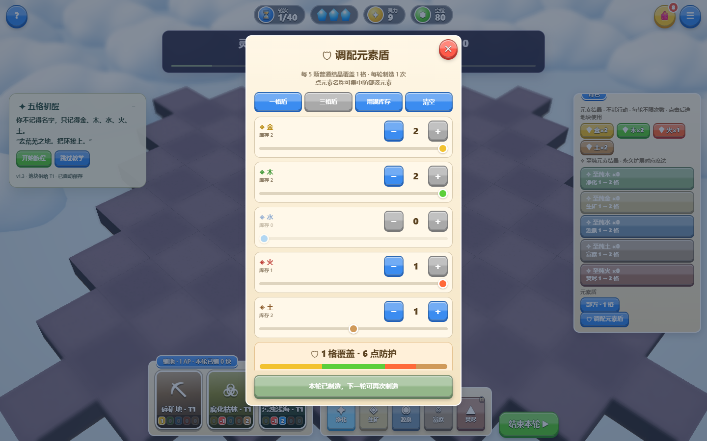
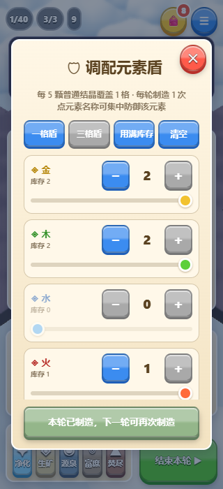

# 元素盾调配修复（2026-10-14）

旧界面制造一次元素盾后同时禁用了调配入口，不能再查看或调整配比；制造按钮也将部分限制误提示为配比数量不符。

现在制造后仍能打开面板和调整配比。实际制造继续遵守每轮一次；制造按钮和预览明确显示本轮已制造、库存不足或配比缺口，并明确需要普通结晶。每5颗普通结晶覆盖1格、制造不消耗AP、配比只在制造成功时扣除的规则保留。

验证：`npm test`通过；`FEEDBACK_UI_ONLY=1 npm run test:feedback`桌面与320px手机模拟33项通过、浏览器错误0，覆盖增减、拖动／触控滑条、Home／End、混合配比、精确扣晶、制造后再次调配、下一轮制造及滚动后的按钮可用性。已检查两种视口截图。

正式发布与线上复测结果随后记录。
